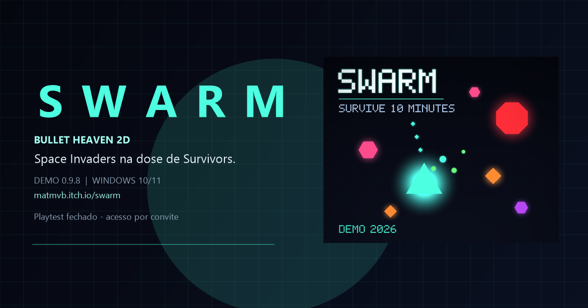

<p align="center">
  
</p>

<h1 align="center">SWARM</h1>

<p align="center">
  <strong>Space Invaders na dose de Survivors.</strong><br>
  Bullet heaven 2D com tiro automático, upgrades por nível, boss às 5:00 e runs de 10 minutos.
</p>

<p align="center">
  <a href="https://matmvb.itch.io/swarm"><strong>Playtest no itch.io</strong></a>
  ·
  <a href="https://matmvb.github.io/swarm/feedback/"><strong>Enviar feedback</strong></a>
  ·
  <a href="https://matmvb.github.io/swarm/">Página do projeto</a>
</p>

<p align="center">
  
  
  
  
</p>

---

## Sobre

**SWARM** é um survivor-like 2D onde você não aperta "atirar" — o sistema atira por você.
Sua decisão é **para onde ir** e **qual upgrade escolher**.

Cada run dura até 10 minutos. Ao subir de nível, o jogo congela e oferece 3 upgrades.
Às 5:00 o **Núcleo** nasce, limpa a horda e transforma a run em um duelo.
Sobreviva até 10:00 para vencer.

> O playtest é fechado. O link e a senha do itch.io são enviados no convite.
> A página pública do jogo fica em [matmvb.itch.io/swarm](https://matmvb.itch.io/swarm).

---

## O que tem na demo 0.9.11

| Conteúdo | Detalhe |
|---|---|
| **6 inimigos** | horda, corredor, tanque, divisor, atirador e boss |
| **Boss** | rajada radial + investida, com telegrafo legível |
| **20 upgrades** | pré-requisitos, efeitos duplos, limites de stack |
| **3 pilotos** | Tanque, Veloz e Atirador |
| **2 armas** | tiro automático e orbes orbitais |
| **Meta-progressão** | gaste Núcleos em bônus permanentes |
| **Áudio procedural** | trilha e SFX sintetizados em tempo real |
| **Visual neon** | pixel art, bloom contido, vinheta e grid em parallax |

Sem loot boxes, anúncios ou pay-to-win.

---

## Jogar o playtest

1. Receba o link e a senha no convite.
2. Baixe o ZIP e extraia a pasta inteira.
3. Execute `SWARM.exe`.
4. Jogue uma run até o boss (5:00) ou até morrer.
5. Responda o [feedback de 3 minutos](https://matmvb.github.io/swarm/feedback/).

### Requisitos

| Item | Valor |
|---|---|
| Sistema | Windows 10/11, 64-bit |
| Gráficos | DirectX 11/12 |
| Espaço | ~110 MB extraídos |
| Entrada | teclado; analógico esquerdo opcional |
| Instalação | não precisa; extraia e execute |

> **SmartScreen:** o executável não é assinado. Se o Windows avisar, clique em
> **Mais informações → Executar assim mesmo**.
> **Áudio:** se abrir mudo, aperte `O` e depois `+`.

---

## Controles

| Tecla | Ação |
|---|---|
| `WASD` / setas | mover |
| `ENTER` | jogar (menu principal) |
| `1` / `2` / `3` | escolher piloto ou upgrade |
| `4` / `5` / `6` | comprar melhorias permanentes |
| `O` | opções |
| `ESC` | pausar / continuar |
| `R` | reiniciar |
| `F1` | overlay de debug (opcional) |
| `F12` | screenshot |

---

## Stack

| Camada | Tecnologia |
|---|---|
| Engine | Unity **6000.6.1f1** |
| Render | URP 17.6 · 2D Renderer |
| Input | Input System 1.19 |
| Linguagem | C# |
| Build | Windows 64-bit · Mono |
| Arte | sprites e efeitos procedurais |
| Áudio | síntese procedural em runtime |
| UI | Canvas + Text legado |

---

## Estrutura do repositório

```
Assets/Swarm/
  Art/            sprites, materiais e ícone
  Data/           ScriptableObjects de inimigos, upgrades e pilotos
  Editor/         gerador de cena, validador e build
  Scenes/         cena Swarm.unity
  Scripts/        gameplay, UI, progressão, áudio e telemetria
docs/             GDD, plano, arquitetura, tutoriais e playtest
Builds/           builds locais (ignoradas pelo Git)
```

---

## Documentação

| Documento | Conteúdo |
|---|---|
| [GDD](docs/01-GDD.md) | o jogo em números |
| [Plano de desenvolvimento](docs/02-PLANO-DEV.md) | sprints e escopo |
| [Setup](docs/03-SETUP.md) | ambiente e primeiro Play |
| [Arquitetura](docs/04-ARQUITETURA.md) | como o código se organiza |
| [Tutoriais](docs/05-TUTORIAL-01-MOVIMENTO.md) | movimento, combate, XP, juice e build |
| [Performance e QA](docs/10-PERFORMANCE-QA.md) | checklist de qualidade |
| [Publicação](docs/11-PUBLICACAO.md) | itch.io, Steam e marketing |
| [Playtest externo](docs/20-PLAYTEST-EXTERNO.md) | como convidar e coletar feedback |
| [Página do itch](docs/17-PAGINA-ITCH.md) | copy e ficha do projeto |
| [Brief de sprites](docs/26-ART-BRIEF-SPRITES.md) | naves, inimigos, tamanhos e Piskel |
| [Auditoria da página](docs/25-AUDITORIA-PAGINA-GITHUB.md) | SEO, Pages, feedback e privacidade |

---

## Desenvolvimento

### Abrir o projeto

1. Instale **Unity 6000.6.1f1** pelo Unity Hub.
2. **Add project from disk** → selecione a pasta do repositório.
3. Abra `Assets/Swarm/Scenes/Swarm.unity`.
4. Aperte **Play**.

### Regenerar a cena

Menu **`SWARM > Montar Protótipo Completo`**.
Para validar referências: **`SWARM > Validar Cena do Protótipo`**.

### Gerar build Windows

Menu **`SWARM > Build Windows`**.

Batch:

```bash
Unity.exe -batchmode -quit \
  -projectPath "C:\caminho\swarm" \
  -executeMethod BuildScript.BuildWindowsBatch
```

A build sai em `Builds/Windows/SWARM.exe`.

---

## Changelog recente

### 0.9.11 — Ship Redesign

- Redesign das três naves: Baluarte com pods/armadura laranja, Vetor com asas e motor verdes, Lança com emissor/cockpit/motor amarelos.
- Sprites 32×32 com margem de 1 px, 6 cores, sem anti-aliasing e sem alpha parcial.
- Portraits 64×64 atualizados a partir dos novos idles.
- Thruster sheets redesenhados com cor de piloto (laranja/verde/amarelo).
- Hit e death sheets recoloridos para a nova paleta.

### 0.9.10 — Combat Visual Polish

- Fase 0: quatro PNGs de projéteis/XP reexportados com filtros válidos; `ArtImportPipeline` agora valida assinatura, chunks, CRC, zlib, scanlines, dimensões e transparência.
- Fase 1: projéteis com cor de time; núcleo branco no jogador, magenta nos inimigos e vermelho/âmbar no boss.
- Explosões de morte coloridas pela classe, com escala por categoria e sequência morte → explosão.
- Camera shake removido de Drone/Corredor; médios com shake leve; boss com shake forte.
- XP dourado separado do crítico laranja; muzzle flash ciano; orbital com núcleo branco.

### 0.9.9

- Integração das naves, inimigos e boss em pixel art.
- Import settings corrigidos (PPU, Point, FullRect, sem compressão).
- Flash de dano por overlay para sprites coloridos.
- Restart por nome da cena, retorno ao menu no game over e ESC nas opções.
- Página e documentação atualizadas para 0.9.9.
- Passe de arte: projéteis/FX/orbes em pixel art, animações de idle/hit/morte, telegraph do Núcleo, charge do Olho, dardo direcional.
- Level up em 3 cards com ícones; seleção de piloto em cards; fonte pixel e wordmark no menu.
- Escala da horda, paleta semântica, Bloom contido e fundo em duas camadas com arena do boss.

### 0.9.8

- Menu principal e tela de pausa.
- Paleta única de UI e hierarquia tipográfica.
- Ícone 1024 aplicado nos 8 slots do executável.
- Correção do Bloom/Vinheta no build (shader stripping + perfil).
- Página de playtest, feedback e política de privacidade no GitHub Pages.
- Correções de lógica no pool de inimigos, alvo da nave e level up.

### 0.9.4

- Boss, orbes, telemetria CSV, 3 pilotos e meta-progressão.
- Build Windows publicada.

---

## Licença e créditos

O SWARM é um projeto proprietário. O código, os sprites, a interface, o nome e
os demais assets originais estão protegidos por direitos autorais.

- **Licença de uso:** [LICENSE](LICENSE)
- **Página pública:** [Licença e créditos](https://matmvb.github.io/swarm/licenca.html)
- **Terceiros:** [THIRD-PARTY-NOTICES.md](THIRD-PARTY-NOTICES.md)
- **Fonte Press Start 2P:** [OFL.txt](Assets/Swarm/Art/Fonts/OFL.txt)

A demo pode ser jogada e gravada para conteúdo com crédito. Redistribuição,
venda, modificação e extração de assets não são permitidas sem autorização.

---

## Feedback

O playtest é anônimo e leva cerca de 3 minutos:

**[Enviar feedback →](https://matmvb.github.io/swarm/feedback/)**

Se encontrar um bug, envie também:

```
%USERPROFILE%\AppData\LocalLow\Scoty\SWARM\Player.log
%USERPROFILE%\AppData\LocalLow\Scoty\SWARM\swarm-runs.csv
```

---

## Contato

- itch.io: [matmvb.itch.io/swarm](https://matmvb.itch.io/swarm)
- Página do projeto: [matmvb.github.io/swarm](https://matmvb.github.io/swarm/)
- Feedback: [formulário de playtest](https://matmvb.github.io/swarm/feedback/)

<p align="center">
  <sub>SWARM · demo 0.9.11 · feito com Unity 6.6 · 2026</sub>
</p>
